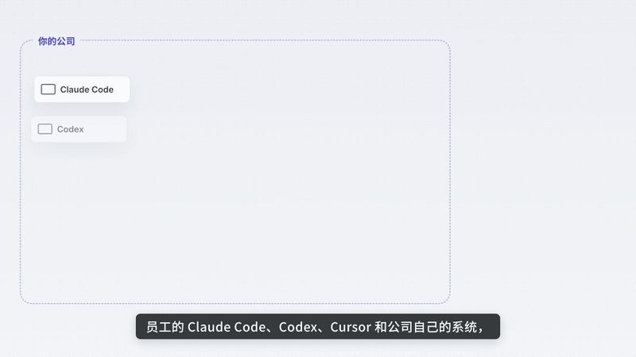
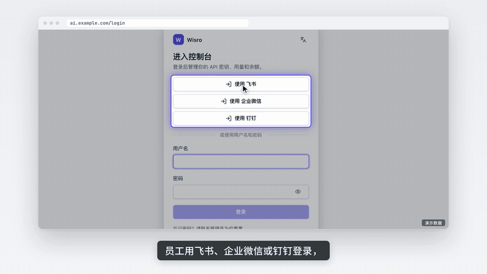
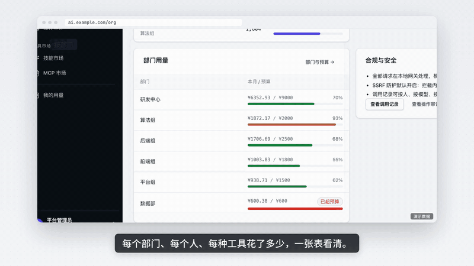

# WiseRoute · Wisro

**A self-hosted AI gateway.** Run it on your own server and put OpenAI, Claude and other model providers behind one address. Everyone gets their own key, and every call and its cost is recorded.

[中文](README.md) · [Docs](https://route.ifootoo.com/docs/en/)



## What it is for

- **Enterprise edition**: give AI to your staff. One place to buy models, budgets per department, data that stays under control, costs you can see.
- **Reseller edition**: buy model access upstream and sell it to customers. Customers sign up and top up themselves; you see revenue, cost and margin.

## Install

A Linux server (2 cores, 4 GB or more) with ports 8080 and 8081 open. Copy one command:

**Enterprise**

```bash
curl -fsSL https://route.ifootoo.com/install.sh | bash -s -- --edition enterprise
```

**Reseller**

```bash
curl -fsSL https://route.ifootoo.com/install.sh | bash -s -- --edition reseller
```

Then open `http://<server>:8081` and enter the setup code the installer printed.

## Features

| Feature | What it does |
|---|---|
| One API | OpenAI and Claude formats. Codex, Claude Code, Cursor and the SDKs work by changing the address |
| Many providers | OpenAI, Anthropic, Azure, AWS, Google and any compatible provider; 36 presets built in |
| Failover | When one provider fails, traffic moves to another and comes back when it recovers |
| Budgets and limits | Department budgets, personal limits, rate limits, approvals; overspending is blocked |
| Exact billing | Each call is reserved, then settled; prices in any currency |
| Request log | The question, answer, images and cost of every call; usage and cost by day |
| Security | Feishu, WeCom, DingTalk and OIDC sign-in; secrets and personal data masked before they leave; every admin change audited |
| Selling | Customer sign-up, online top-up, redemption codes, low-balance reminders (Reseller) |

## See it

The clips are from our Chinese intro video; the screens are the real console.

**Copy the config and go**: staff sign in with Feishu, WeCom or DingTalk and copy a ready Claude Code or Codex config.



**Every cost in one table**: spend per department, person and tool; a spent budget blocks the next call; a failing upstream is routed around.



**Sensitive data stays inside**: secrets and ID numbers are masked; customer names go out as placeholders and come back restored.


## Performance

| | |
|---|---|
| Throughput | About **80,000 requests/s** on one machine, every request billed exactly |
| Added latency | **Under 1 ms** of gateway overhead |
| Memory | About **28 MB** idle; a 2-core, 4 GB cloud server is enough |
| Large files | Video and other large downloads at about **6.6 GB/s** (kernel zero-copy) |

Measured on an i9-10900K against a local mock upstream.

## Images

- Docker Hub: `ifootoo/wiseroute`
- Aliyun (mainland China): `crpi-qecnvpqw46ro2why.cn-shanghai.personal.cr.aliyuncs.com/footoo/wiseroute`

x86_64 and ARM64.

## Contact

biz@ifootoo.com

The source code is not public. Free to run for your own use; hosting for others or reselling needs a commercial licence.
