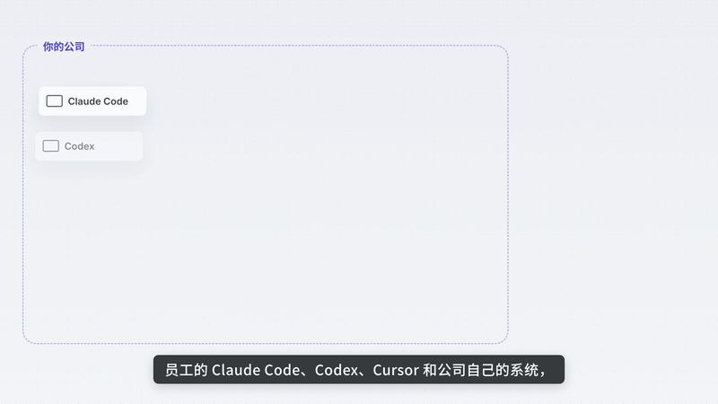
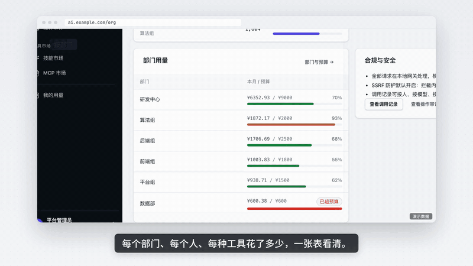

# Wisro · 微路由

**私有化 AI 网关。** 装在你自己的服务器上，把 OpenAI、Claude、国内各家模型接到一个地址。每个人领一把密钥，用多少、花多少都有记录。

[English](README.en.md) · [文档](https://route.ifootoo.com/docs/)



## 用来做什么

- **企业版**：公司给员工用 AI。统一采购模型，按部门分预算，管住数据不外泄，花费清清楚楚。
- **运营版**：采购上游模型，加价卖给客户。客户自己注册、充值，你看收入、成本和毛利。

## 安装

准备一台 Linux 服务器（2 核 4 GB 起），放行 8080 和 8081 端口，复制一条命令运行：

**企业版**

```bash
curl -fsSL https://route.ifootoo.com/install.sh | bash -s -- --edition enterprise
```

**运营版**

```bash
curl -fsSL https://route.ifootoo.com/install.sh | bash -s -- --edition reseller
```

装好后打开 `http://<服务器>:8081`，填入屏幕上打印的设置码。国内服务器会自动从阿里云下载，不用配置加速。

## 功能

| 功能 | 说明 |
|---|---|
| 统一接口 | 同时支持 OpenAI 和 Claude 格式。Codex、Claude Code、Cursor、各种 SDK 改个地址就能用 |
| 多家上游 | OpenAI、Claude、Azure、AWS、Google 以及任何兼容服务商，内置 36 个预设 |
| 自动切换 | 一家出故障，自动切到另一家，恢复后再切回来 |
| 预算与额度 | 部门预算、个人额度、限速、审批，超了自动拦住 |
| 精确计费 | 每次调用先预扣再结算，支持人民币、美元等任意货币 |
| 调用记录 | 每次调用的问题、回答、图片和费用都能查，按天看用量和成本 |
| 安全 | 飞书、企业微信、钉钉、OIDC 登录；发出前自动遮住密钥和个人信息；管理操作全部留痕 |
| 运营 | 客户注册、在线充值、兑换码、余额不足提醒（运营版） |

## 看看效果

**复制配置就能用**：员工用飞书 / 企业微信 / 钉钉登录，Claude Code、Codex 的配置一键复制。


**花费一张表看清**：每个部门、每个人、每种工具花了多少；预算用完自动拦住；上游出错自动换路。



**敏感信息不出门**：密钥、身份证号自动打码；客户名换成代号发出，回答回来再还原。


## 性能

| | |
|---|---|
| 吞吐 | 单机约 **8 万次请求/秒**，每次都精确记账 |
| 额外延迟 | 网关自身转发开销 **不到 1 毫秒** |
| 内存 | 空载约 **28 MB**，2 核 4 GB 的云主机就能跑 |
| 大文件 | 视频等大文件内核直传，约 **6.6 GB/s** |

测试环境：i9-10900K，本地模拟上游。

## 镜像下载

- Docker Hub：`ifootoo/wiseroute`
- 阿里云：`crpi-qecnvpqw46ro2why.cn-shanghai.personal.cr.aliyuncs.com/footoo/wiseroute`

支持 x86_64 和 ARM64。

## 联系

biz@ifootoo.com

源代码不公开。可免费部署自用；为他人托管或转售需要商业授权。
